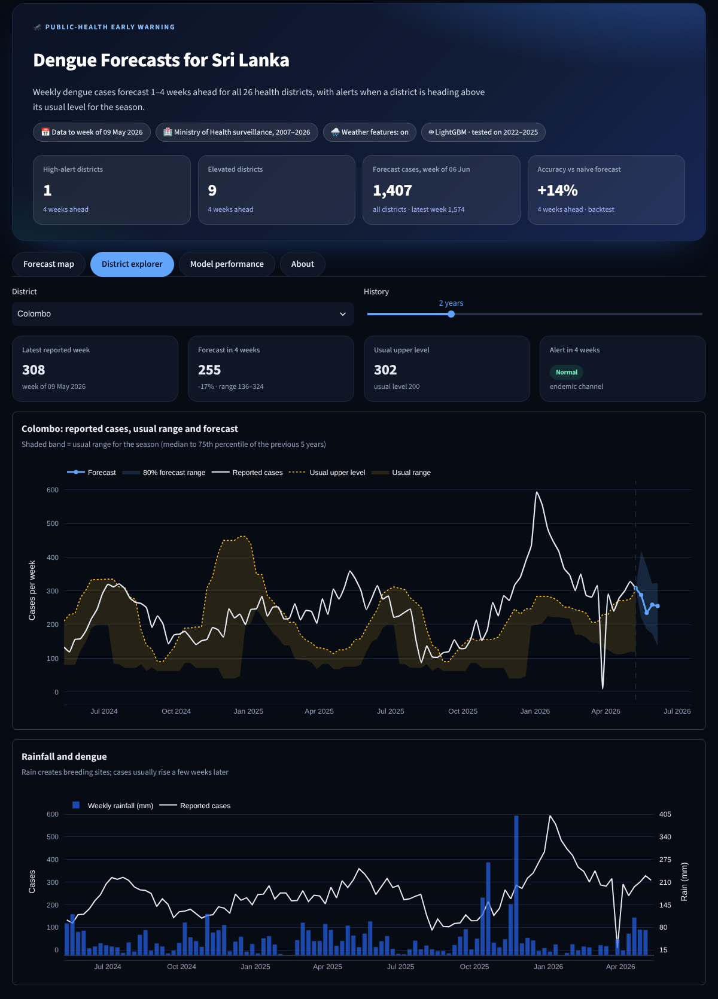
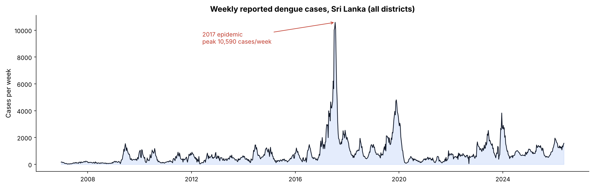
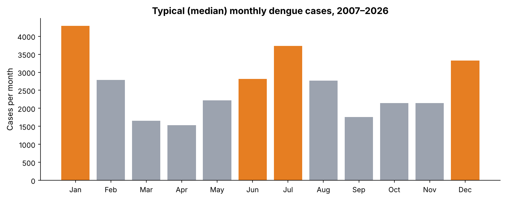
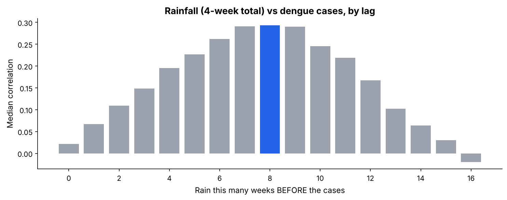
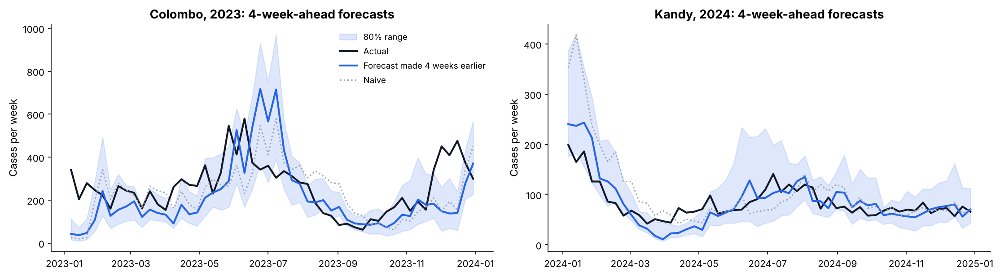

# 🦟 Dengue Early Warning — Sri Lanka

**Forecasting weekly dengue cases in all 26 health districts of Sri Lanka, 1–4 weeks ahead, and
flagging districts where cases are likely to rise above their usual level.** Built on 19 years
of official Ministry of Health surveillance data (2007–2026), with an honest time-based backtest,
prediction ranges and an interactive Streamlit dashboard.

> **Live dashboard:** _add your Streamlit link here_ (see [Deploy](#deploy-the-dashboard-free))



---

## Why

Dengue is Sri Lanka's biggest mosquito-borne disease. In 2017 the country had a record epidemic of
about **175,000 reported cases**, three times a normal year. A few weeks' warning lets health
teams plan clean-up campaigns, fogging and hospital capacity before cases peak.

## Data

| Source | What | Coverage |
|---|---|---|
| Epidemiology Unit, Ministry of Health: Weekly Epidemiological Reports, via the [`denguedatahub`](https://github.com/thiyangt/denguedatahub) package (Dr. Thiyanga S. Talagala) | Weekly reported cases per district | Dec 2006 – May 2026, 26 districts, 26,311 rows |
| [NASA POWER](https://power.larc.nasa.gov/) | Daily rainfall, temperature, humidity per district | Dec 2006 – May 2026, 185,172 rows |



Dengue has **two peaks a year**, following the south-west (May–Sep) and north-east (Dec–Feb) monsoons:



## Approach

- **Problem framing:** at week *t*, forecast week *t + h* for h = 1–4, with **one model per horizon**.
- **One global LightGBM model** for all 26 districts. Small districts learn from big ones.
- **Target = change in log cases** from this week. Tree models can't predict above values seen in
  training, so predicting the *change* lets them follow record epidemics.
- **Features (only data available at forecast time):** last 8 weeks, rolling averages (4–26 weeks),
  trend, the same season last year, the national trend, week of year, and rainfall, temperature
  and humidity from 0–3, 4–7 and 8–11 weeks earlier.
  A unit test checks that changing future data never changes the features.
- **Prediction ranges:** extra quantile models (10% and 90%) give an 80% range.
- **Alerts:** the epidemiological **endemic channel**: a district is *Elevated* when it is
  likely to exceed the 75th percentile of the same season over the previous 5 years.
  The alert threshold is tuned on 2019–2021, never on the test years.

## Results: honest backtest 2022–2025

Expanding window: for each test year, the model is trained only on earlier data and forecasts
every week of that year, exactly as it would be used in real life.

| Weeks ahead | **Model MAE** | Naive (same as this week) | Avg of last 4 weeks | Same week last year | Gain vs naive |
|---|---|---|---|---|---|
| 1 | **11.7** | 12.4 | 13.3 | 29.2 | 5.1% |
| 2 | **13.2** | 14.2 | 15.4 | 29.2 | 7.2% |
| 3 | **14.5** | 16.6 | 17.3 | 29.2 | 12.3% |
| 4 | **15.8** | 18.4 | 19.1 | 29.2 | 14.2% |

*MAE = average error in cases per district per week.* The model beats naive in every test year,
including the sudden 2023 surge.

**Does rainfall help?** Yes, for longer horizons, as the biology predicts:

| Weeks ahead | Without weather | With weather | Gain |
|---|---|---|---|
| 1 | 11.73 | 11.73 | 0% |
| 2 | 13.23 | 13.15 | 0.6% |
| 3 | 15.07 | 14.53 | 3.6% |
| 4 | 16.33 | 15.75 | 3.5% |

Rain is most strongly linked to cases about **8 weeks later** (after removing the seasonal pattern),
and weather makes up about 19% of what the 4-week model relies on.



**Outbreak alerts** (will a district go above its usual upper level?):

| Weeks ahead | Model F1 | Naive F1 | Model recall | Naive recall |
|---|---|---|---|---|
| 1 | **0.703** | 0.695 | 0.689 | 0.697 |
| 2 | **0.688** | 0.667 | **0.708** | 0.672 |
| 3 | **0.668** | 0.637 | **0.730** | 0.646 |
| 4 | 0.622 | **0.625** | 0.591 | **0.637** |

Alerts beat the naive approach 1–3 weeks ahead and are on par 4 weeks ahead.



**What I learned**
- *"Same as this week" is a strong baseline* for weekly epidemics. The model's gain grows with the
  horizon (5% → 14%), because seasonality, longer trends and rainfall matter more further ahead.
- *Weather only helps where biology says it should:* no gain one week ahead, about 3.5% three to four
  weeks ahead, since rain → mosquito breeding → infections takes weeks.
- *Data cleaning isn't always better:* sudden one-week reporting drops (often around the April New
  Year holidays) look like errors, but cleaning them made forecasts worse, because a dip predicts a
  catch-up spike the next week.
- *Thresholds tuned on validation years don't always transfer:* the 4-week alert threshold chosen on
  2019–2021 was only on par with naive on 2022–2025. I report it rather than re-tune on test data.

**Limitations:** reported cases ≠ infections (testing and reporting delays); 80% ranges cover
about 74% of outcomes (slightly over-confident); this is a portfolio project, not an official tool.

## Project structure

```
├── Dengue_Forecasting.ipynb  # full analysis: EDA → data quality → backtest → alerts → conclusions
├── dengue.py                 # core logic: loading, features, models, backtest, endemic channel
├── train.py                  # backtest + final models + forecasts -> outputs/
├── app.py                    # Streamlit dashboard (reads outputs/, starts instantly)
├── fetch_dengue.py           # downloads the latest case data
├── fetch_weather.py          # downloads NASA POWER weather per district
├── data/                     # dengue_weekly.csv, weather_daily.csv, district_coords.csv
├── outputs/                  # backtest.csv, metrics.json, forecast_latest.csv, ...
├── models/                   # trained LightGBM models (one per horizon)
├── images/                   # figures for this README
└── tests/test_dengue.py      # 14 tests incl. data-leakage and baseline checks
```

## Run it

```bash
pip install -r requirements.txt
python fetch_weather.py     # weather data (already included; re-run to refresh, ~1 min)
python train.py             # backtest + train + forecasts (~3 min)
streamlit run app.py        # open the dashboard
pytest                      # run the tests
```

To update with new weeks of data: `python fetch_dengue.py`, then `python train.py`.

## Deploy the dashboard (free)

1. Push this repo to GitHub (including the `outputs/` folder).
2. Go to [share.streamlit.io](https://share.streamlit.io), sign in with GitHub, click **Create app**,
   pick this repo and set the main file to `app.py`.
3. Copy the link into the top of this README and into your LinkedIn post.

## Tech stack

Python · pandas · NumPy · LightGBM (incl. quantile regression) · scikit-learn-style backtesting ·
Plotly · Streamlit · Matplotlib / Seaborn · pytest
